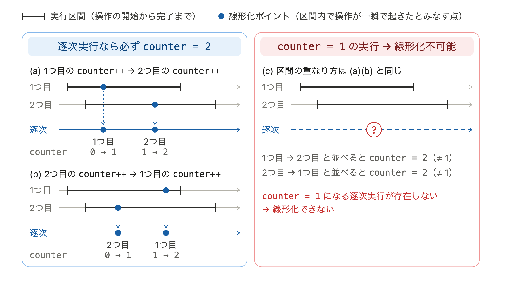
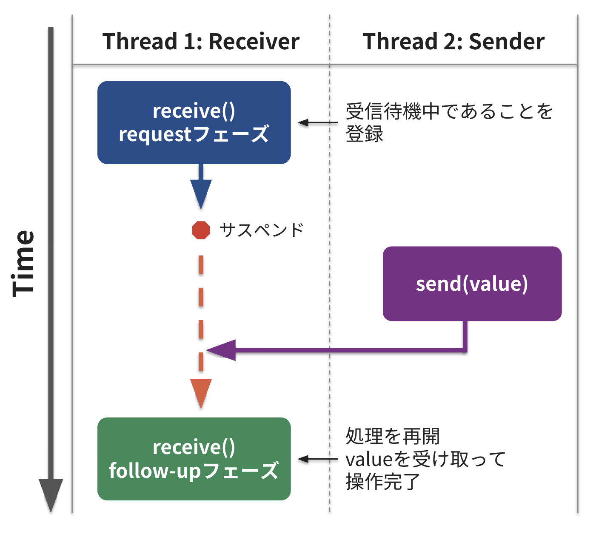

<!-- {"layout": "title"} -->

# 祈るテストから、探索するテストへ

## 〜Lincheckではじめる並行処理テスト〜

---

<!-- {"layout": "section"} -->

# 自己紹介

## はじめまして

---

<!-- {"layout": "aboutme"} -->

# 自己紹介

## ▼ 名前

本田 雄亮

## ▼ 所属企業

LINE Digital Frontier株式会社

## ▼ Xアカウント

@yyh_gl

<!-- https://x.com/yyh_gl -->

---

<!-- {"layout": "section"} -->

# 会社紹介

## ちょっとだけ

---

<!-- {"layout": "aboutcompany"} -->

# LINE Digital Frontier株式会社

3つのサービスを運営中。
私は主に『LINEマンガ』を開発しています📚️

<!-- https://ldfcorp.com/ -->

---

<!-- {"layout": "content"} -->

# スポンサーブースやってます

アーキテクチャボードを掲示中。<br>

LINEマンガコインやEBJクーポンが当たる抽選会もやってます🎁
ぜひお立ち寄りください！

---

<!-- {"layout": "agenda"} -->

# アジェンダ

1. 再現しない並行処理の不具合
1. Lincheckを使った並行処理テスト
1. suspend関数への適用
1. まとめ

<!-- TODO: agenda確定したらデザイン変える -->

---

<!-- {"layout": "content"} -->

# サンプルコードおよび参考資料

本発表で使用するサンプルコード（Kotlin Playgroundのリンク）や
参考資料のリンクはスライドのスピーカーノートに記載しています。
お好きなタイミングでご参照ください。<br>

※ 非同期処理の動きは実行環境に大きく依存するので
　 必ずしも同じ動作にはなりません。

---

<!-- {"layout": "section"} -->

# 1. 再現しない並行処理の不具合

## 祈っていませんか？

---

<!-- {"layout": "content"} -->

# 正しく見えるコード

2つのスレッドから、1つのカウンターを
それぞれ1万回インクリメントする。
結果は `20,000` になるはず。

```kotlin
var counter = 0

fun main() {
    val t1 = thread { repeat(10_000) { counter++ } }
    val t2 = thread { repeat(10_000) { counter++ } }
    t1.join()
    t2.join()
    println(counter) // 20,000 ?
}
```

<!-- https://pl.kotl.in/aPyhp4ZbQm -->

---

<!-- {"layout": "content-with-comment"} -->

# 実行してみると

同じコードなのに実行するたびに結果が異なる。<br>

1回目: 20000
2回目: 18756 ← ！？
3回目: 20000<br>

並行処理ではあるあるな不具合。<br>

実行のたびに結果が変わる処理がテストに紛れ込むと
「たまに落ちるテスト」ができあがる。<br>

そんなとき、我々は **"祈る"**。

## 今日はすぐ直った！<br>PCの機嫌がいいみたい！

---

<!-- {"layout": "content-and-conclusion"} -->

# 「祈るテスト」の日常

みなさんも心当たりはないでしょうか。<br>

- CIでだけ、たまに落ちるテスト
- とりあえずrerunしたら通った（ので後日確認します）<br>

並行処理の不具合は「必ず再現するわけではない」という点で
通常の不具合と性質が根本的に異なる。
私たちはその検証を諦め、テストの成功を祈ることがある。

## 祈るテスト ＝ テストの成否が運任せ

---

<!-- {"layout": "section"} -->

# なぜ再現しないのか

---

<!-- {"layout": "content"} -->

# さっきのコードを見てみる

`counter++` というシンプルなコード。
結果がずれるのはなぜ？

```kotlin
var counter = 0

fun main() {
    val t1 = thread { repeat(10_000) { counter++ } }
    val t2 = thread { repeat(10_000) { counter++ } }
    t1.join()
    t2.join()
    println(counter)
}
```

<!-- https://pl.kotl.in/aPyhp4ZbQm -->

---

<!-- {"layout": "content"} -->

# `counter++` の裏側

`counter++` は1つの操作ではない。
実際には3つのステップに分かれて実行される。<br>

1. counterの現在値を読む（read）
2. 読んだ値に1を足す（add）
3. 結果をcounterへ書き戻す（write）

---

<!-- {"layout": "content"} -->

# 実行順序①： 想定通りの挙動

Thread 1がread→add→writeを完了させてから
Thread 2が同じ処理を行うと
2回のインクリメントがどちらも反映される。

| 順  | Thread 1 | Thread 2 | counter |
| --- | -------- | -------- | ------- |
| 1   | read → 0 |          | 0       |
| 2   | add → 1  |          | 0       |
| 3   | write 1  |          | 1       |
| 4   |          | read → 1 | 1       |
| 5   |          | add → 2  | 1       |
| 6   |          | write 2  | **2**   |

---

<!-- {"layout": "content"} -->

# 実行順序②： 想定とは異なる挙動

次の順序で交互に実行されると
片方のインクリメントが消えたように見える（ロストアップデート）。

| 順  | Thread 1 | Thread 2 | counter |
| --- | -------- | -------- | ------- |
| 1   | read → 0 |          | 0       |
| 2   |          | read → 0 | 0       |
| 3   | add → 1  |          | 0       |
| 4   |          | add → 1  | 0       |
| 5   | write 1  |          | 1       |
| 6   |          | write 1  | **1**   |

---

<!-- {"layout": "content-and-conclusion"} -->

# どのように実行されるかは運任せ

スレッドの切り替わり方（インターリービング）が違うことにより
結果が変わる。<br>

テストでは、たくさんの可能性の中から毎回1つだけが実行されるので
成功するか失敗するかは運任せになる。

## そして、我々は ”祈る”

---

<!-- {"layout": "content-with-comment"} -->

# 実行順序の組み合わせ爆発

この「たくさんの可能性」とは、実際にはどれくらいの数なのか。<br>

2スレッドが各3ステップを実行するだけでも20通り。
各10ステップなら184,756通り。
（スレッド内の各ステップ実行順序は固定）<br>

実際のコードはさらに複雑な可能性も…

## むりぽ<br><br>┐（´ー｀）┌

<!-- 20 = C(6,3)、184756 = C(20,10) -->

---

<!-- {"layout": "content-and-conclusion"} -->

# テストで見つけるのは難しい

通常のテストは1回の実行につき、
無数にある順序のうちの1つしか試せない。<br>

不具合を踏む順序を引き当てるかどうかは運次第。<br>

だからリトライしても再現しないし、
リトライで通っても不具合が直ったわけではない。

## 1回の実行は、無数の順序のうちのたった1つ

---

<!-- {"layout": "section"} -->

# 4. Lincheck

---

<!-- {"layout": "content-and-conclusion"} -->

# Lincheckとは

JetBrains製の並行処理テストフレームワーク。<br>

- kotlinx.coroutines自体の品質保証に組み込まれ、
  MutexやSemaphore, Channelといったコア機能の検証で
  実際に使われている
- 著名な並行処理関連のライブラリ（JCTools）にて
  不具合を発見した実績がある

## coroutinesの品質を影で支えているツール

<!-- https://github.com/JetBrains/lincheck -->
<!-- https://github.com/Kotlin/kotlinx.coroutines/tree/master/kotlinx-coroutines-core/jvm/test/lincheck -->
<!-- https://link.springer.com/chapter/10.1007/978-3-031-37706-8_8 の"1 Introduction"-->

---

<!-- {"layout": "section"} -->

# モデル検査とストレステスト

## Lincheckによる不具合検知

---

<!-- {"layout": "content"} -->

# 2つの探索戦略

不具合を検知するために、様々な実行順序を実際に試してみる。
Lincheckは2つの戦略でこれを実現する。<br>

- モデル検査：実行順序そのものを制御し、**系統的に探索する**
- ストレステスト：シナリオを大量に実行し、**確率的に探索する**

<!-- https://kotlinlang.org/docs/lincheck-testing-strategies.html -->

---

<!-- {"layout": "content"} -->

# 戦略①：モデル検査（Model checking）

JVMのスケジューラに任せず、Lincheckがスレッドの切り替えを制御。
本制御を通して系統的に探索する戦略。<br>

- 運に頼らない
  - 同じ入力なら必ず同じ結果になる（決定的）ので
    見つけた不具合を確実に再現可能
- 失敗時は「どの順序で壊れたか」のトレースを出力

```kotlin
@Test
fun modelCheckingTest() = ModelCheckingOptions().check(this::class)
```

<!-- https://kotlinlang.org/docs/lincheck-model-checking.html -->

---

<!-- {"layout": "content"} -->

# 戦略②：ストレステスト

様々なテストシナリオを大量に実行し、
多様な実行順序を引き当てにいく戦略（デフォルトで数万回規模）。
→ 試行回数を増やし、不具合を踏む確率を上げる。<br>

- Lincheckによるスレッド制御はなく、<br>実環境に近い挙動を確認できる
- 確率的な探索であり、網羅性および再現性は保証されない

```kotlin
@Test
fun stressTest() = StressOptions().check(this::class)
```

<!-- https://kotlinlang.org/docs/lincheck-testing-strategies.html#stress-testing -->

---

<!-- {"layout": "content"} -->

# 2つの戦略の使い分け

モデル検査とストレステストの併用がおすすめ。

|                | モデル検査                         | ストレステスト             |
| -------------- | ---------------------------------- | -------------------------- |
| 探索方法       | 順序を制御して<br>系統的に探索     | 大量実行         |
| 再現性         | 高い（決定的）                     | 低い（確率的）                       |
| 失敗トレース   | あり                               | なし                       |
| 向いている用途 | ロジックの<br>不具合検出・デバッグ | 実環境に近い挙動の確認 |

---

<!-- {"layout": "content-and-conclusion", "freeze": true} -->

# 探索は証明ではない

モデル検査もストレステストも、探索には限りがある。<br>

- モデル検査
  - 探索するシナリオ数および試行回数には上限がある
  - 特性上、検知できない不具合もある
- ストレステスト
  - 確率的な探索であり、試行回数が少なければ<br>不具合を引き当てられない
    - 試行回数が多くても不具合を踏む確率は100%ではない


## 不具合を検知できない可能性（偽陰性）がある

<!-- https://kotlinlang.org/docs/lincheck-model-checking.html#relaxed-java-memory-model -->

---

<!-- {"layout": "content-and-conclusion"} -->

# だから、「不要」というわけではない

偽陰性のリスクはあるが、不具合を検知できる可能性は
大幅に上がる。<br>

モデル検査は一度検知した不具合を確実に再現できる。<br>

※ 試行回数を増やすほど検知できる可能性は上がるが、
　 実行時間とのトレードオフになる。<br>

## 「祈る」を「探索」に。これが大きなメリット

---

<!-- {"layout": "section"} -->

# 「正しい」の定義

---

<!-- {"layout": "content"} -->

# 「正しい」を定義してはじめて検知できる

モデル検査もストレステストも、
様々な実行パターンを生成できることはわかった。<br>

では、生成した実行結果が正しいかどうかは、どのように判定する？<br>

**Lincheckは「線形化可能性」を用いて正しさを判定する。**
（デフォルト設定における挙動。変更可能）

---

<!-- {"layout": "content-with-comment"} -->

# 線形化可能性による正しさチェック

並行実行した操作が、実行順序（実時刻の前後関係）を保ったまま、
1つずつ逐次実行した結果のどれかと一致することが
確認できればOK。<br>

なお、並行実行では各操作に
呼び出しから応答までの幅（実行区間）がある。
線形化可能性では実行区間のどこか1点で
瞬時に（atomically）実行されたとみなす。

## 文章だけじゃわからん

<!-- https://dl.acm.org/doi/10.1145/41625.41627 -->
<!-- https://kotlinlang.org/docs/lincheck-results-validation.html#sequential-specification -->

---

<!-- {"layout": "content"} -->

# カウンターのコードを例に説明

`counter` の値が1になるときと、2になるときがあった。

```kotlin
var counter = 0

fun main() {
    val t1 = thread { repeat(10_000) { counter++ } }
    val t2 = thread { repeat(10_000) { counter++ } }
    t1.join()
    t2.join()
    println(counter)
}
```

---

<!-- {"layout": "content"} -->

# カウンターのコードを例に説明



---

<!-- {"layout": "section"} -->

# 5. suspend関数のテスト

## Kotlinと言えばCoroutines、Coroutinesと言えばsuspend

---

<!-- {"layout": "content""} -->

# suspendする関数のテストは難しいの？

例として、`Channel` の `send` と `receive` を見てみる。<br>

Senderがいなければ `receive` はサスペンドする。
これは不具合ではなく、仕様どおりの正しい挙動。<br> 

しかし、`receive` がずっとサスペンドすると、
後続の処理が進まないため、逐次実行と等価な結果を得られない。
つまり、線形化可能性を満たすかのチェックができない。

```kotlin
val channel = Channel<Int>()
channel.receive() // wait forever ...
```

---

<!-- {"layout": "content","freeze": false} -->

# Lincheckのアプローチ

Dual Data Structures理論に基づき、
サスペンドする操作を別の視点で捉える。<br>

操作を以下の通り分解。
- 要求の登録（request）
- 再開・完了（follow-up）<br>

本分離により逐次実行の結果と
比較できるようになり、
線形化可能性の判定が行える。



<!-- https://link.springer.com/chapter/10.1007/978-3-540-30186-8_13 -->

---

<!-- {"layout": "section", "freeze": false} -->

# 7. ここまでの内容を振り返る

## では、最後に…

---

<!-- {"layout": "content-and-conclusion"} -->

# 本日の振り返り

- 並行処理の不具合は**再現しにくい**
  - 原因は実行順序の組み合わせ爆発
- Lincheckを使った並行処理テスト
  - モデル検査とストレステストで様々な実行順序を探索
  - 正しさは線形化可能性で定義
- suspend関数も検証可能
  - 「要求の登録」と「再開・完了」に分解
     （Dual Data Structures理論）

## 祈るテストから、探索するテストへ

---

<!-- {"layout": "end"} -->

end

---

<!-- {"layout": "references"} -->

# 参考資料

- JetBrains. ["Overview"](https://kotlinlang.org/docs/lincheck-guide.html). Kotlin Documentation. 出版年不明, (参照 2026-11-03).
- Nikita Koval. ["How we test concurrent algorithms in Kotlin Coroutines by Nikita Koval"](https://www.youtube.com/watch?v=jZqkWfa11Js). YouTube (Kotlin by JetBrains). 2023, (参照 2026-11-03).
- Maria Sokolova. ["Workshop. Lincheck: Testing concurrency on the JVM (Part 1)"](https://www.youtube.com/watch?v=YNtUK9GK4pA). YouTube (Hydra). 2021, (参照 2026-11-03).
- Maria Sokolova. ["Workshop. Lincheck: Testing concurrency on the JVM (Part 2)"](https://www.youtube.com/watch?v=EW7mkAOErWw). YouTube (Hydra). 2021, (参照 2026-11-03).
- Nikita Koval, et al. "Lincheck: A Practical Framework for Testing Concurrent Data Structures on JVM". Computer Aided Verification (CAV 2023) Part I. Lecture Notes in Computer Science, vol.13964. Constantin Enea, Akash Lal編. Cham, Springer, 2023, p.156-169. DOI: [10.1007/978-3-031-37706-8_8](https://doi.org/10.1007/978-3-031-37706-8_8).
- Maurice P. Herlihy, Jeannette M. Wing. Linearizability: A Correctness Condition for Concurrent Objects. ACM Transactions on Programming Languages and Systems. 1990, vol.12, no.3, p.463-492. DOI: [10.1145/78969.78972](https://doi.org/10.1145/78969.78972).

---

<!-- {"layout": "reference-repositories"} -->

# 参考リポジトリ

- [JetBrains/lincheck](https://github.com/JetBrains/lincheck)
- [openjdk/jcstress](https://github.com/openjdk/jcstress)
- [Kotlin/kotlinx.coroutines](https://github.com/Kotlin/kotlinx.coroutines/)

---

<!-- {"layout": "section"} -->

# 補足資料

---

<!-- {"layout": "section"} -->

# Lincheckの使い方

---

<!-- {"layout": "content"} -->

# テスト対象を宣言

テストしたい操作に `@Operation` を付けるだけでよい。
シナリオは（基本的に）書かなくてよい。

```kotlin
class UnsafeCounter {
    private var value = 0
    fun inc() {
        value++
    }
    fun get(): Int = value
}

class UnsafeCounterTest {
    private val counter = UnsafeCounter()

    @Operation
    fun inc() = counter.inc()

    @Operation
    fun get(): Int = counter.get()

    @Test
    fun modelCheckingTest() = ModelCheckingOptions().check(this::class)

    @Test
    fun stressTest() = StressOptions().check(this::class)
}
```

<!-- https://pl.kotl.in/azc9HV9il -->

---

<!-- {"layout": "content"} -->

# 残りは全部Lincheckがやる

宣言した操作からLincheckがテストを行う。<br>

1. シナリオ生成：複数スレッドでの様々な実行順序を自動生成
2. 実行：モデル検査またはストレステストで探索
3. 判定：線形化可能かをチェック<br>

「どう探索し、どう判定するか」はフレームワークの仕事。
開発者は「何をテストするか」だけを書けばよい。

---

<!-- {"layout": "section"} -->

# Lincheckによるスレッド制御

---

<!-- {"layout": "content"} -->

# モデル検査の仕組み：スイッチポイントを差し込む

バイトコードを書き換えて、共有変数の読み書きやロックなど
コンテキストスイッチが起こりうる箇所に「スイッチポイント」を
挿入する。<br>

- Lincheck自身のスケジューラが、どのスイッチポイントで
  どのスレッドへ切り替えるかを決める
- スケジュールを自分で制御しているからこそ、
  壊れた順序をそのまま再生できる

<!-- https://doi.org/10.1007/978-3-031-37706-8_8 -->
<!-- https://www.youtube.com/watch?v=YNtUK9GK4pA -->

---

<!-- {"layout": "section"} -->

# その他

---

<!-- {"layout": "content"} -->

# Lincheckの注意点・制約

- モデル検査
  - 前提とするメモリモデルの制約
  - ファイルやソケットなどのI/O呼び出しに非対応
- 実行時間：探索するため、通常のユニットテストより時間がかかる
- 偽陰性のリスク：探索範囲（iterations/invocations）を小さくすると不具合を見逃す
  - CIの実行時間とのトレードオフになる

<!-- https://kotlinlang.org/docs/lincheck-model-checking.html#i-o-api-calls -->

---

<!-- {"layout": "content"} -->

# Prompt cancellation に対応

対応してるよー<br>

https://kotlinlang.org/docs/lincheck-operation-execution-options.html#prompt-cancellation
