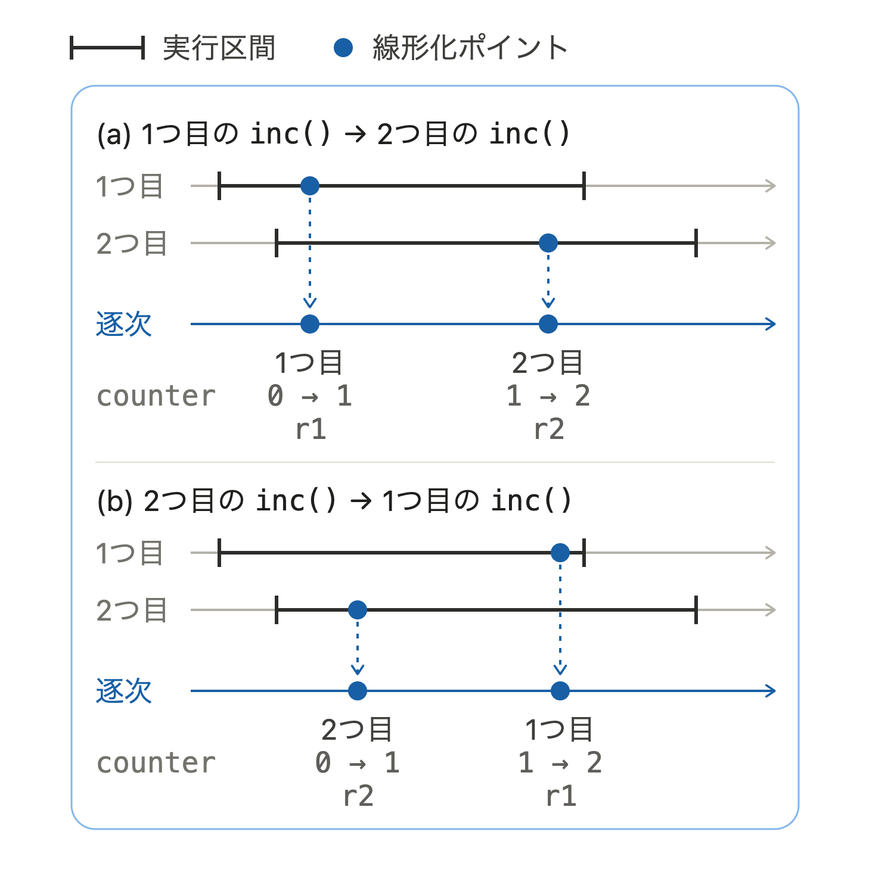

<!-- {"layout": "title"} -->

# 祈るテストから、探索するテストへ

## 〜Lincheckではじめる並行処理テスト〜

---

<!-- {"layout": "section"} -->

# 自己紹介

## はじめまして

---

<!-- {"layout": "aboutme"} -->

# 自己紹介

## ▼ 名前

本田 雄亮

## ▼ 所属企業

LINE Digital Frontier株式会社

## ▼ Xアカウント

@yyh_gl

<!-- https://x.com/yyh_gl -->

---

<!-- {"layout": "section"} -->

# 会社紹介

## ちょっとだけ

---

<!-- {"layout": "aboutcompany"} -->

# LINE Digital Frontier株式会社

本に関するサービスを複数運営中。
私は主に『LINEマンガ』を開発しています📚️

<!-- https://ldfcorp.com/ -->

---

<!-- {"layout": "content"} -->

# スポンサーブースやってます

アーキテクチャボードを掲示中。<br>

LINEマンガコインやEBJクーポンが当たる抽選会もやってます🎁
ぜひお立ち寄りください！

---

<!-- {"layout": "agenda"} -->

# アジェンダ

1. 再現しない並行処理の不具合
1. Lincheckを使った並行処理テスト
1. suspend関数のテスト
1. まとめ

---

<!-- {"layout": "content"} -->

# サンプルコードおよび参考資料

本発表で使用するサンプルコード（Kotlin Playgroundのリンク）や
参考資料のリンクはスライドのスピーカーノートに記載しています。
お好きなタイミングでご参照ください。<br>

※ 非同期処理の動きは実行環境に大きく依存するので
　 必ずしも同じ動作にはなりません。

---

<!-- {"layout": "section"} -->

# 1. 再現しない並行処理の不具合

## 祈っていませんか？

---

<!-- {"layout": "content"} -->

# 正しく見えるコード

2つのスレッドから、1つのカウンターを
それぞれ1万回インクリメントする。
結果は `20,000` になるはず。

```kotlin
var counter = 0

fun main() {
    val t1 = thread { repeat(10_000) { counter++ } }
    val t2 = thread { repeat(10_000) { counter++ } }
    t1.join()
    t2.join()
    println(counter) // 20,000 ?
}
```

<!-- https://pl.kotl.in/aPyhp4ZbQm -->

---

<!-- {"layout": "content-with-comment", "freeze": true} -->

# 実行してみると

同じコードなのに実行するたびに結果が異なる。<br>

1回目: 20000
2回目: 18756 ← ！？
3回目: 20000<br>

並行処理ではあるあるな不具合。<br>

実行のたびに結果が変わる処理がテストに紛れ込むと
「たまに落ちるテスト」ができあがる。<br>

そんなとき、我々は **"祈る"**。

## 今日はすぐ直った！<br>PCの機嫌がいいみたい！

---

<!-- {"layout": "content-and-conclusion"} -->

# 「祈るテスト」の日常

みなさんも心当たりはないでしょうか。<br>

- CIでだけ、たまに落ちるテスト
- とりあえずrerunしたら通った（ので後日確認します）<br>

並行処理の不具合は「必ず再現するわけではない」という点で
他の不具合と性質が根本的に異なる。
私たちはその検証を諦め、テストの成功を祈ることがある。

## 祈るテスト ＝ テストの成否が運任せ

---

<!-- {"layout": "section"} -->

# なぜ再現しないのか

---

<!-- {"layout": "content"} -->

# さっきのコードを見てみる

`counter++` というシンプルなコード。
結果がずれるのはなぜ？

```kotlin
var counter = 0

fun main() {
    val t1 = thread { repeat(10_000) { counter++ } }
    val t2 = thread { repeat(10_000) { counter++ } }
    t1.join()
    t2.join()
    println(counter)
}
```

<!-- https://pl.kotl.in/aPyhp4ZbQm -->

---

<!-- {"layout": "content"} -->

# `counter++` の裏側

`counter++` は1つの操作ではない。
実際には3つのステップに分かれて実行される。<br>

1. counterの現在値を読む（read）
2. 読んだ値に1を足す（add）
3. 結果をcounterへ書き戻す（write）

---

<!-- {"layout": "content"} -->

# 実行順序①： 想定通りの挙動

Thread 1がread→add→writeを完了させてから
Thread 2が同じ処理を行うと
2回のインクリメントがどちらも反映される。

| 順  | Thread 1 | Thread 2 | counter |
| --- | -------- | -------- | ------- |
| 1   | read → 0 |          | 0       |
| 2   | add → 1  |          | 0       |
| 3   | write 1  |          | 1       |
| 4   |          | read → 1 | 1       |
| 5   |          | add → 2  | 1       |
| 6   |          | write 2  | **2**   |

---

<!-- {"layout": "content"} -->

# 実行順序②： 想定とは異なる挙動

次の順序で交互に実行されると
片方のインクリメントが消えたように見える（ロストアップデート）。

| 順  | Thread 1 | Thread 2 | counter |
| --- | -------- | -------- | ------- |
| 1   | read → 0 |          | 0       |
| 2   |          | read → 0 | 0       |
| 3   | add → 1  |          | 0       |
| 4   |          | add → 1  | 0       |
| 5   | write 1  |          | 1       |
| 6   |          | write 1  | **1**   |

---

<!-- {"layout": "content-and-conclusion"} -->

# どのように実行されるかは運任せ

スレッドの切り替わり方（インターリービング）が違うことにより
結果が変わる。<br>

テストでは、たくさんの可能性の中から毎回1つだけが実行されるので
成功するか失敗するかは運任せになる。

## そして、我々は ”祈る”

---

<!-- {"layout": "content-with-comment", "freeze": true} -->

# 実行順序の組み合わせ爆発

この「たくさんの可能性」とは、実際にはどれくらいの数なのか。<br>

2スレッドが各3ステップを実行するだけでも20通り。
各10ステップなら184,756通り。
（スレッド内の各ステップ実行順序は固定）<br>

実際のコードはさらに複雑な可能性も…

## むりぽ<br><br>┐（´ー｀）┌

<!-- 20 = C(6,3)、184756 = C(20,10) -->

---

<!-- {"layout": "content-and-conclusion"} -->

# テストで見つけるのは難しい

テストは1回の実行につき、
無数にある順序のうちの1つしか試せない。<br>

不具合を踏む順序を引き当てるかどうかは運次第。<br>

だからリトライしても再現しないし、
リトライで通っても不具合が直ったわけではない。

## 1回の実行は、無数の順序のうちのたった1つ

---

<!-- {"layout": "section", "freeze": true} -->

# 2. Lincheckを使った並行処理テスト

---

<!-- {"layout": "content-and-conclusion"} -->

# Lincheckとは

JetBrains製の並行処理テストフレームワーク。<br>

- kotlinx.coroutines自体の品質保証に組み込まれ、
  MutexやSemaphore, Channelといったコア機能の検証で
  実際に使われている
- 著名な並行処理関連のライブラリ（JCTools）にて
  不具合を発見した実績がある

## Coroutinesの品質を陰で支えているツール

<!-- https://github.com/JetBrains/lincheck -->
<!-- https://github.com/Kotlin/kotlinx.coroutines/tree/master/kotlinx-coroutines-core/jvm/test/lincheck -->
<!-- https://link.springer.com/chapter/10.1007/978-3-031-37706-8_8 の"1 Introduction"-->

---

<!-- {"layout": "section"} -->

# モデル検査とストレステスト

## Lincheckによる不具合検知

---

<!-- {"layout": "content"} -->

# 2つの探索戦略

不具合を検知するために、様々な実行順序を実際に試してみる。
Lincheckは2つの戦略でこれを実現する。<br>

- モデル検査：実行順序そのものを制御し、**系統的に探索する**
- ストレステスト：シナリオを大量に実行し、**確率的に探索する**

<!-- https://kotlinlang.org/docs/lincheck-testing-strategies.html -->

---

<!-- {"layout": "content"} -->

# 戦略①：モデル検査（Model checking）

実行環境のスケジューラに任せず、Lincheckがスレッドの切り替えを
制御。
本制御を通して系統的に探索する戦略。<br>

- 運に頼らない
  - 同じ入力なら必ず同じ結果になる（決定的）ので
    見つけた不具合を確実に再現可能
- 失敗時は「どの順序で壊れたか」のトレースを出力

```kotlin
@Test
fun modelCheckingTest() = ModelCheckingOptions().check(this::class)
```

<!-- https://kotlinlang.org/docs/lincheck-model-checking.html -->

---

<!-- {"layout": "content"} -->

# 戦略②：ストレステスト（Stress testing）

Lincheckがスレッドの切り替えを制御せず、
様々なテストシナリオを大量に実行し、多様な実行順序を
引き当てにいく戦略。<br>

- 実環境に近い挙動を確認できる
- モデル検査と比較して、
  実行スピードが速いので同一時間あたりの試行回数を増やせる
- 確率的な探索であり、網羅性および再現性は保証されない

```kotlin
@Test
fun stressTest() = StressOptions().check(this::class)
```

<!-- https://kotlinlang.org/docs/lincheck-testing-strategies.html#stress-testing -->

---

<!-- {"layout": "content"} -->

# 2つの戦略の使い分け

モデル検査を主軸に、ストレステストの併用を推奨。

|                | モデル検査                         | ストレステスト             |
| -------------- | ---------------------------------- | -------------------------- |
| 探索方法       | 順序を制御して系統的に探索     | 大量に実行して<br>確率的に探索（順序制御なし） |
| スピード       | ストレステストより遅い     |モデル検査より速い|
| 再現性         | 高い（決定的）                     | 低い（確率的）                       |
| 失敗トレース   | あり                               | なし                       |
| 向いている用途 | ロジックの<br>不具合検出・デバッグ | 実環境に近い挙動の確認 |

<!-- 両者の根本的な違いは、スレッド切り替え（インターリーブ）の制御方法 -->
<!-- https://doi.org/10.1007/978-3-031-37706-8_8 -->
<!-- https://kotlinlang.org/docs/lincheck-testing-strategies.html#choose-a-strategy -->

---

<!-- {"layout": "content-and-conclusion", "freeze": true} -->

# 探索は証明ではない

モデル検査もストレステストも、探索には限りがある。<br>

- モデル検査
  - 探索には上限があり、全順序を網羅できるわけではない
  - 特性上、検知できない不具合がある
    - 逐次一貫性のあるメモリモデルを前提としており、
      そのモデルの範囲外の不具合 など
- ストレステスト
  - 確率的な探索であり、十分な試行回数がなければ<br>不具合を引き当てられない


## 不具合を検知できない可能性（偽陰性）がある

<!-- https://kotlinlang.org/docs/lincheck-model-checking.html#relaxed-java-memory-model -->

---

<!-- {"layout": "content-and-conclusion"} -->

# だから、「不要」というわけではない

偽陰性のリスクはあるが、不具合を検知できる可能性は
大幅に上がる。<br>

モデル検査は一度検知した不具合を確実に再現できる。<br>

シナリオ数および試行回数を増やせば検知できる可能性は上がる。
※ 実行時間とのトレードオフ

## 「祈る」を「探索」に。これが大きなメリット

---

<!-- {"layout": "section"} -->

# 「正しい」の定義

---

<!-- {"layout": "content"} -->

# 「正しい」を定義してはじめて検知できる

モデル検査もストレステストも、
様々な実行パターンを生成できることはわかった。<br>

では、生成した実行結果が正しいかどうかは、どのように判定する？<br>

**Lincheckは「線形化可能性」を用いて正しさを判定する。**
（デフォルト設定における挙動。変更可能）

---

<!-- {"layout": "content-with-comment", "freeze": true} -->

# 線形化可能性による正しさチェック

ざっくり言うと、実行順序（実時刻の前後関係）を守りつつ、
並行実行と同じ結果を再現できる
逐次実行方法があるかをチェックする。<br>

厳密な話をすると、<br>

「並行実行では各操作に呼び出しから
応答までの幅（実行区間）がある」ことや、
「操作は実行区間内で瞬時に実行されたように
見えるポイント（線形化ポイント）がある」<br>

…などの話がある。ここでは雰囲気だけ掴んでおけばOK。

## 文章だけじゃわからん

<!-- https://doi.org/10.1145/78969.78972 -->
<!-- https://kotlinlang.org/docs/lincheck-results-validation.html#sequential-specification -->
<!-- 便宜上「実行区間」というワードを用いている -->

---

<!-- {"layout": "content"} -->

# コードを例に説明

実行すると `(r1, r2)` の値は
以下のいずれかになる。<br>

- `(1, 1)`　
- `(1, 2)`　
- `(2, 1)`　
- `(2, 2)`<br>

このような結果をもたらす
逐次実行方法があるかを見る。

```kotlin
var counter = 0

fun inc(): Int = ++counter

fun main() {
    var r1 = 0
    var r2 = 0
    val t1 = thread { r1 = inc() }
    val t2 = thread { r2 = inc() }
    t1.join()
    t2.join()
    println("$r1, $r2")
}
```

<!-- https://pl.kotl.in/74JCQog_G -->
<!-- (2, 2)が起きる理由: ++counterはKotlinでは
     「書き込み→counterを読み直して返す」というバイトコードになる
     （getstatic → iconst_1 → iadd → putstatic → getstatic → ireturn）。
     そのため両スレッドの書き込みが両方終わってから
     両者が読み直すと、どちらも最終値の2を返しうる。 -->

---

<!-- {"layout": "content"} -->

# どんな逐次実行があるかチェック

(a)
1つ目の `inc()` が先に実行され、
続いて、2つ目の `inc()` が
実行される。<br>

(b)
2つ目の `inc()` が先に実行され、
続いて、1つ目の `inc()` が
実行される。<br>

この2通りが存在。
（これがすべて）



---

<!-- {"layout": "content-and-conclusion"} -->

# 逐次実行で再現可能かチェック

並行実行時に得られる
r1とr2の値の組み合わせ `(r1, r2)` について<br>

- `(1, 2)` は (a) の逐次実行で再現可能
- `(2, 1)` は (b) の逐次実行で再現可能
- **`(1, 1)` と `(2, 2)` は
  どの逐次実行でも再現不可能**


## Lincheckが不具合を検知！

---

<!-- {"layout": "content"} -->

# 少しだけ補足

線形化可能性は、最終的なデータの状態を見るのではなく、
並行処理された各操作が逐次実行の履歴と
整合するかをチェックする。<br>

さきほどの説明も、最終的な `counter` の値ではなく、
各 `inc()`（操作）の動きに着目している。<br><br>

ちなみに、Lincheckは最終状態のチェックもサポートしている。

<!-- https://kotlinlang.org/docs/lincheck-results-validation.html#validation -->

---

<!-- {"layout": "section"} -->

# 3. suspend関数のテスト

## Kotlinと言えばCoroutines、Coroutinesと言えばsuspend

---

<!-- {"layout": "content"} -->

# suspendする関数のテストは難しい？

例として、`Channel` の `send` と `receive` を見てみる。<br>

`send` と `receive` を並行に実行すると両方とも成功する。<br>

しかし、逐次実行すると、どちらを先に呼んでも
相手がいないためサスペンドしたまま処理が進まない。
つまり、並行実行の結果を再現できる逐次実行が存在せず、
従来の線形化可能性では判定できない。

```kotlin
val channel = Channel<Int>(Channel.RENDEZVOUS)
runBlocking {
    launch { channel.send(1) }
    launch { channel.receive() }
}
```

<!-- RENDEZVOUS（capacity=0、デフォルト）はバッファを持たないため、
     sendとreceiveが同時に揃ったときだけ値の受け渡しが成立する。
     片方だけ呼ばれている間はサスペンドして待つ。 -->
<!-- https://pl.kotl.in/qqlQsBB81 -->

---

<!-- {"layout": "content"} -->

# Lincheckのアプローチ

Dual Data Structures理論に基づき、
サスペンドする操作を別の視点で捉える。<br>

操作を以下の通り分解。
- 要求の登録（request）
- 再開・完了（follow-up）<br>

本分離により逐次実行の結果と
比較できるようになり、
線形化可能性の判定が行える。


<!-- https://link.springer.com/chapter/10.1007/978-3-540-30186-8_13 -->

---

<!-- {"layout": "section"} -->

# 4. まとめ

## では、最後に…

---

<!-- {"layout": "content-and-conclusion"} -->

# まとめ

- 並行処理の不具合は**再現しにくい**
  - 原因は実行順序の組み合わせ爆発
- Lincheckを使った並行処理テスト
  - モデル検査とストレステストで様々な実行順序を探索
  - 正しさは線形化可能性で定義
- suspend関数も検証可能
  - 「要求の登録」と「再開・完了」に分解
     （Dual Data Structures理論）

## 祈るテストから、探索するテストへ

---

<!-- {"layout": "end"} -->

end

---

<!-- {"layout": "references"} -->

# 参考資料

- JetBrains. ["Overview"](https://kotlinlang.org/docs/lincheck-guide.html). Kotlin Documentation. 出版年不明, (参照 2026-11-03).
- Nikita Koval. ["How we test concurrent algorithms in Kotlin Coroutines by Nikita Koval"](https://www.youtube.com/watch?v=jZqkWfa11Js). YouTube (Kotlin by JetBrains). 2023, (参照 2026-11-03).
- Maria Sokolova. ["Workshop. Lincheck: Testing concurrency on the JVM (Part 1)"](https://www.youtube.com/watch?v=YNtUK9GK4pA). YouTube (Hydra). 2021, (参照 2026-11-03).
- Maria Sokolova. ["Workshop. Lincheck: Testing concurrency on the JVM (Part 2)"](https://www.youtube.com/watch?v=EW7mkAOErWw). YouTube (Hydra). 2021, (参照 2026-11-03).
- Nikita Koval, et al. "Lincheck: A Practical Framework for Testing Concurrent Data Structures on JVM". Computer Aided Verification (CAV 2023) Part I. Lecture Notes in Computer Science, vol.13964. Constantin Enea, Akash Lal編. Cham, Springer, 2023, p.156-169. DOI: [10.1007/978-3-031-37706-8_8](https://doi.org/10.1007/978-3-031-37706-8_8).
- Maurice P. Herlihy, Jeannette M. Wing. "Linearizability: A Correctness Condition for Concurrent Objects". ACM Transactions on Programming Languages and Systems. 1990, vol.12, no.3, p.463-492. DOI: [10.1145/78969.78972](https://doi.org/10.1145/78969.78972).
- William N. Scherer III, Michael L. Scott. "Nonblocking Concurrent Data Structures with Condition Synchronization". Distributed Computing (DISC 2004). Lecture Notes in Computer Science, vol.3274. Rachid Guerraoui編. Berlin, Heidelberg, Springer, 2004, p.174-187. DOI: [10.1007/978-3-540-30186-8_13](https://doi.org/10.1007/978-3-540-30186-8_13).

---

<!-- {"layout": "reference-repositories"} -->

# 参考リポジトリ

- [JetBrains/lincheck](https://github.com/JetBrains/lincheck)
- [openjdk/jcstress](https://github.com/openjdk/jcstress)
- [Kotlin/kotlinx.coroutines](https://github.com/Kotlin/kotlinx.coroutines/)

---

<!-- {"layout": "section"} -->

# 補足資料

---

<!-- {"layout": "section"} -->

# Lincheckの使い方

---

<!-- {"layout": "content"} -->

# テスト対象を宣言

テストしたい操作に `@Operation` を付けるだけでよい。
シナリオは（基本的に）書かなくてよい。

```kotlin
class UnsafeCounter {
    private var value = 0
    fun inc() {
        value++
    }
    fun get(): Int = value
}

class UnsafeCounterTest {
    private val counter = UnsafeCounter()

    @Operation
    fun inc() = counter.inc()

    @Operation
    fun get(): Int = counter.get()

    @Test
    fun modelCheckingTest() = ModelCheckingOptions().check(this::class)

    @Test
    fun stressTest() = StressOptions().check(this::class)
}
```

<!-- https://pl.kotl.in/azc9HV9il -->

---

<!-- {"layout": "content"} -->

# 残りは全部Lincheckがやる

宣言した操作からLincheckがテストを行う。<br>

1. シナリオ生成：各スレッドで呼ぶ操作と引数の組み合わせを
  　　　　　　　自動生成
2. 実行：モデル検査またはストレステストで
  　　　様々な実行順序（インターリービング）を探索
3. 判定：線形化可能かをチェック<br>

「どう探索し、どう判定するか」はフレームワークの仕事。
開発者は「何をテストするか」だけを書けばよい。

---

<!-- {"layout": "section"} -->

# Lincheckによるスレッド制御

---

<!-- {"layout": "content"} -->

# モデル検査の仕組み：スイッチポイントを差し込む

バイトコードを書き換えて、共有変数の読み書きやロックなど
他スレッドとの干渉が起こりうる箇所に「スイッチポイント」を
挿入する。<br>

- Lincheck自身のスケジューラが、どのスイッチポイントで
  どのスレッドへ切り替えるかを決める
- スケジュールを自分で制御しているからこそ、
  壊れた順序をそのまま再生できる

<!-- https://doi.org/10.1007/978-3-031-37706-8_8 -->
<!-- https://www.youtube.com/watch?v=YNtUK9GK4pA -->

---

<!-- {"layout": "section"} -->

# その他

---

<!-- {"layout": "content"} -->

# Lincheckの注意点・制約

- モデル検査
  - 前提とするメモリモデルの制約
  - ファイルやソケットなどのI/O呼び出しに非対応
- 実行時間：探索するため、通常のユニットテストより時間がかかる
- 偽陰性のリスク：探索範囲（iterations/invocations）を
  小さくすると不具合を見逃す
  - CIの実行時間とのトレードオフになる

<!-- https://kotlinlang.org/docs/lincheck-model-checking.html#i-o-api-calls -->

---

<!-- {"layout": "content"} -->

# 線形化可能性の補足

- 並行システムの実行は履歴によってモデル化される
  - 履歴とは、操作の呼び出しおよび応答イベントの
    有限なシーケンスのこと
- 実行区間が被らない操作同士は実行順序を必ず守る
  - 実行区間が被る＝並行実行
  - 実行区間が被らないなら、どちらが先に実行されたかは明確

---

<!-- {"layout": "content"} -->

# Prompt cancellation に対応

対応してるよー<br>

https://kotlinlang.org/docs/lincheck-operation-execution-options.html#prompt-cancellation
